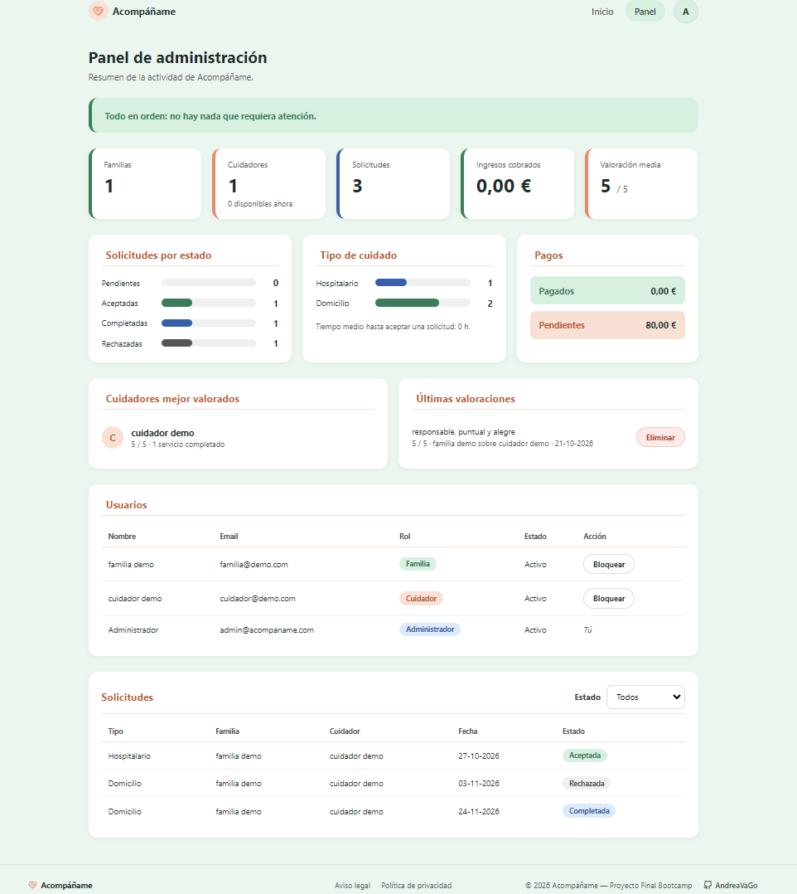
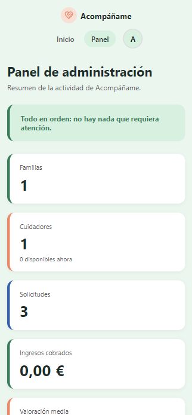

# 🤝 Acompáñame — Frontend

**Acompáñame** es una plataforma de marketplace que conecta a familias que necesitan cuidados para un ser querido con cuidadores profesionales verificados. Nace para cubrir el hueco entre la atención residencial a tiempo completo y las listas de espera de la atención formal.

Este repositorio contiene la **aplicación web** del proyecto, desarrollada con **Vue 3**. La API REST (Spring Boot) vive en un repositorio independiente, enlazado más abajo.

Proyecto final del bootcamp de Desarrollo Web Full Stack (850h) en **Factoría F5 — Digital Academy**.

    

> [!TIP]
> 📚 **Documentación completa en la [wiki del proyecto](https://github.com/AndreaVaGo/acompaname-frontend/wiki).** Aquí está lo imprescindible para entender, arrancar y probar el frontend; el detalle (decisiones, diseño, diagramas y tests) está en la wiki.

---

## 📑 Tabla de contenidos

- [Descripción del proyecto](#-descripción-del-proyecto)
- [Tecnologías utilizadas](#-tecnologías-utilizadas)
- [Instalación y uso](#-instalación-y-uso)
- [Estructura del proyecto](#-estructura-del-proyecto)
- [Pantallas y rutas](#-pantallas-y-rutas)
- [Panel de administración](#-panel-de-administración)
- [Decisiones técnicas](#-decisiones-técnicas)
- [Diseño y capturas](#-diseño-y-capturas)
- [Diagramas técnicos](#-diagramas-técnicos)
- [Tests](#-tests)
- [Herramientas](#-herramientas)
- [Enlaces del proyecto](#-enlaces-del-proyecto)
- [Problemas conocidos](#-problemas-conocidos)
- [Próximos pasos](#-próximos-pasos)
- [Autora](#-autora)

---

## 📖 Descripción del proyecto

**Acompáñame** resuelve un problema real: encontrar apoyo puntual y de confianza para el cuidado de personas mayores o dependientes, sin necesidad de contratar servicios residenciales completos.

Las **familias** pueden:
- 📝 Registrarse e iniciar sesión
- 🔎 Buscar cuidadores con filtros (ciudad, tipo de cuidado, sexo, servicios, disponibilidad, vehículo, valoración mínima y fechas libres) y consultar su perfil y sus reseñas
- 📋 Enviar solicitudes de servicio y seguir su estado
- 💳 Pagar el servicio (el pago se marca como completado en el backend, se muestra una confirmación y la solicitud pasa a verse como pagada; los datos de la tarjeta son de prueba)
- ⭐ Valorar el servicio una vez completado y ver en el historial qué servicios ya están valorados
- 👤 Editar sus datos de contacto y cambiar la contraseña

Los **cuidadores** pueden:
- 🧑‍⚕️ Registrarse y gestionar su perfil profesional
- 📥 Recibir solicitudes y aceptarlas o rechazarlas
- 👤 Editar sus datos de contacto y cambiar la contraseña

El **administrador** puede:
- 📊 Ver un panel con el resumen de la actividad (familias, cuidadores, solicitudes, ingresos y valoración media), gráficos de barras y los avisos que requieren atención
- 🚫 Bloquear y desbloquear cuentas de usuario
- 🗑️ Eliminar valoraciones inadecuadas
- 📋 Consultar todas las solicitudes, filtradas por estado

Cualquier visitante puede consultar el **aviso legal** y la **política de privacidad** desde el pie de página.

---

## 🛠 Tecnologías utilizadas

| Categoría | Tecnología |
|---|---|
| 🖖 Framework | Vue 3 (Composition API, <mark>&lt;script setup&gt;</mark>) |
| ⚡ Build tool | Vite 8 |
| 🍍 Estado | Pinia |
| 🧭 Rutas | Vue Router 5 |
| 🔌 Consumo de API | Repository Pattern sobre <mark>fetch</mark> con Basic Auth |
| 🎨 Estilos | CSS puro, BEM y variables CSS |
| 🧪 Tests | Vitest, Vue Test Utils, jsdom |

---

## 🚀 Instalación y uso

```bash
# Clonar el repositorio
git clone https://github.com/AndreaVaGo/acompaname-frontend.git

# Entrar en la carpeta del proyecto
cd acompaname-frontend

# Instalar las dependencias
npm install

# Arrancar el servidor de desarrollo
npm run dev
```

La aplicación quedará disponible en <mark>http://localhost:5173</mark> 🎉.

> [!IMPORTANT]
> Para que funcione completamente, el backend debe estar arrancado en <mark>http://localhost:8080</mark> (ver el README del repositorio de backend). Para entrar como administrador, el backend tiene que haberse arrancado con las variables <mark>ADMIN_EMAIL</mark> y <mark>ADMIN_PASSWORD</mark>; en ese README se explica cómo.

| Comando | Descripción |
|---|---|
| <mark>npm run dev</mark> | Servidor de desarrollo |
| <mark>npm run build</mark> | Build de producción |
| <mark>npm run preview</mark> | Previsualizar el build |
| <mark>npm run test:unit</mark> | Ejecutar los tests |

---

## 📁 Estructura del proyecto

```
src/
├── assets/          Imágenes, bocetos y diagramas
├── components/      NavBar, AppFooter, SolicitudCard, FotoCuidador (reutilizables)
│   └── admin/       Piezas del panel: Avisos, Tarjetas, Barras, Pagos, Cuidadores, Valoraciones, Usuarios y Solicitudes
├── pinia/           Configuración de Pinia
├── repositories/    Admin, Auth, Cuidador, Pago, Role, Solicitud, Usuario, Valoracion + Repository base
├── router/          Definición de rutas
├── stores/          auth.js (estado de sesión)
├── styles/          variables.css, base.css, style.css
├── tests/           Tests de componentes, vistas, rutas, store y repositorios
├── utils/           catalogoCuidados.js, formatearEuros.js, formatearFecha.js, mensajeDeError.js, reducirImagen.js
├── views/           Una vista por pantalla, en carpetas: admin, auth, caregiver, common, family
├── App.vue
└── main.js
```

Esta estructura separa claramente responsabilidades: las **vistas** (<mark>views/</mark>) representan pantallas completas, los **componentes** (<mark>components/</mark>) contienen piezas reutilizables entre vistas, los **repositorios** (<mark>repositories/</mark>) encapsulan toda la comunicación con la API, el **store** (<mark>stores/</mark>) centraliza el estado de sesión, y los **estilos globales** (<mark>styles/</mark>) evitan duplicar valores de diseño (colores, espaciados) en cada archivo.

---

## 📱 Pantallas y rutas

| # | Pantalla | Ruta | Descripción |
|---|---|---|---|
| 1 | 🏠 **Landing** | <mark>/</mark> | Página pública de bienvenida, con propuesta de valor y accesos a registro/login |
| 2 | ✍️ **Registro** | <mark>/registro</mark> | Formulario con selección de rol (Familia / Cuidador), cargado dinámicamente desde la API |
| 3 | 🔑 **Inicio de sesión** | <mark>/login</mark> | Acceso con email y contraseña; el administrador entra directamente en su panel |
| 4 | 🔍 **Búsqueda de cuidadores** | <mark>/buscar</mark> | Listado con filtros por ciudad, tipo de cuidado, sexo, servicios, disponibilidad, vehículo propio, valoración mínima y fechas (oculta a los cuidadores que ya tienen un servicio aceptado esos días) |
| 5 | 🧑‍⚕️ **Perfil de cuidador** (público) | <mark>/cuidador/:id</mark> | Datos profesionales, valoración media y ventana con las reseñas de las familias |
| 6 | 📝 **Solicitud de servicio** | <mark>/solicitar/:id</mark> | Formulario para pedir el acompañamiento a un cuidador concreto (tipo de cuidado, dirección u hospital, fechas, paciente y necesidades) |
| 7 | ✅ **Confirmación de solicitud** | <mark>/confirmacion</mark> | Aviso de solicitud enviada |
| 8 | 📜 **Historial de solicitudes** | <mark>/historial</mark> | Estado final de cada acompañamiento; la familia puede valorar y ve cuáles ya están valoradas |
| 9 | 📨 **Solicitudes enviadas** (Familia) | <mark>/solicitudes</mark> | Estado de las solicitudes enviadas a distintos cuidadores |
| 10 | 💳 **Checkout** (Familia) | <mark>/pagar/:id</mark> | Pago de un servicio (tarjeta de prueba) con pantalla de confirmación |
| 11 | ⭐ **Formulario de valoración** (Familia) | <mark>/valorar/:id</mark> | Puntuación de 1 a 5 estrellas y comentario |
| 12 | 📥 **Solicitudes recibidas** (Cuidador) | <mark>/solicitudes-cuidador</mark> | Gestión de aceptar/rechazar |
| 13 | 👤 **Mi perfil** (Familia) | <mark>/mi-perfil</mark> | Datos de la cuenta |
| 14 | ✏️ **Editar perfil** (Cuidador) | <mark>/editar-perfil</mark> | Foto (se elige desde el ordenador), especialidad, ciudad, tipo y servicios de cuidado, sexo, experiencia, tarifa, descripción, vehículo y disponibilidad |
| 15 | 🧾 **Editar datos** | <mark>/editar-datos</mark> | Cambiar nombre, email y teléfono |
| 16 | 🔐 **Cambiar contraseña** | <mark>/cambiar-password</mark> | Contraseña actual, nueva y repetida |
| 17 | ⚖️ **Aviso legal** | <mark>/aviso-legal</mark> | Datos del titular y condiciones de uso (público) |
| 18 | 🛡️ **Política de privacidad** | <mark>/privacidad</mark> | Cómo se tratan los datos personales (público) |
| 19 | 📊 **Panel de administración** (Administrador) | <mark>/admin</mark> | Resumen de la actividad, gráficos, avisos, valoraciones, usuarios y solicitudes |

Las rutas privadas comprueban en el router que haya sesión y, cuando hace falta, el rol (<mark>FAMILIA</mark>, <mark>CUIDADOR</mark> o <mark>ADMIN</mark>); si no se cumple, redirigen al login.

Cada vista incluye sus correspondientes estados vacíos (por ejemplo, "Aún no tienes solicitudes") y mensajes de error ante fallos de carga o de envío, para que la interfaz nunca se muestre rota ni en blanco.

---

## 🛡 Panel de administración

Pantalla **/admin**, solo para el rol <mark>ADMIN</mark>. El administrador **observa y modera**: no edita solicitudes ni pagos, no borra usuarios y no puede hacerse pasar por otra cuenta.

| Bloque | Qué muestra |
|---|---|
| ⚠️ Avisos | Qué requiere atención (por ejemplo, solicitudes pendientes) y un botón que baja a la tabla de solicitudes ya filtrada |
| 🔢 Tarjetas | Familias, cuidadores (y cuántos están disponibles ahora), solicitudes, ingresos cobrados y valoración media |
| 📊 Barras | Solicitudes por estado y por tipo de cuidado, con el tiempo medio hasta aceptar una solicitud |
| 💶 Pagos | Importe pagado y pendiente |
| ⭐ Valoraciones | Cuidadores mejor valorados y últimas valoraciones, con botón **Eliminar** y confirmación en la propia fila |
| 👥 Usuarios | Tabla con rol y estado; botón **Bloquear / Desbloquear** (en su propia fila se ve «Tú», porque no puede bloquearse a sí mismo) |
| 📋 Solicitudes | Tabla con filtro por estado |

Detalles de diseño:

- El menú del administrador solo tiene **Panel**, **Cambiar contraseña** y **Cerrar sesión**: no lleva «Mi perfil» ni «Editar mis datos», para que el email del administrador (que se crea desde el backend) no pueda cambiar desde la web.
- Los gráficos son solo texto y CSS, sin librerías de gráficos.
- En **móvil** (menos de 640 px), las tablas de usuarios y solicitudes se convierten en tarjetas con etiqueta y valor, para que el botón Bloquear siempre esté a la vista.
- Si una cuenta está bloqueada, el login muestra «Email o contraseña incorrectos, o tu cuenta está bloqueada.» (el backend responde igual que con una contraseña mala).

---

## 🧩 Decisiones técnicas

📄 Documento completo con el proceso y los problemas encontrados: [docs/decisiones-tecnicas.pdf](docs/decisiones-tecnicas.pdf)

Algunas de las decisiones principales:

- 🎨 **BEM + variables CSS globales** para colores, radios y espaciados.
- 🔌 **Repository Pattern** para el consumo de la API: cada entidad tiene su repositorio, que extiende una clase base.
- 🍍 **Estado de sesión con Pinia** (<mark>useAuthStore</mark>), persistido en <mark>sessionStorage</mark>.
- 🧭 **<mark>NavBar</mark> compartido**, que muestra enlaces distintos según el rol (familia, cuidador o administrador).
- 🔎 **Filtros de búsqueda en el navegador** y **filtro por fechas con ayuda del backend** (<mark>GET /solicitudes/cuidadores-ocupados</mark>).
- 📱 **Diseño responsive** con media queries (punto de corte de 768 px).
- 🛡️ **Panel de administración dividido en componentes** pequeños (uno por bloque) que reciben los datos por <mark>props</mark> y avisan con eventos; la vista <mark>AdminView</mark> es la única que habla con la API.
- 📊 **Gráficos hechos con CSS**, sin librerías, para no añadir dependencias.
- 🗑️ **Confirmación en la propia fila** al eliminar una valoración, en vez de una ventana emergente.
- 📱 **Tablas que se convierten en tarjetas en móvil**, con CSS y atributos <mark>data-label</mark>, sin duplicar el contenido.
- 🔒 **El administrador no puede bloquearse a sí mismo**, ni en el backend ni en el frontend.

👉 Todas las decisiones y la metodología de trabajo: [Decisiones técnicas](https://github.com/AndreaVaGo/acompaname-frontend/wiki/Decisiones-tecnicas).

---

## 🎨 Diseño y capturas

Proceso de diseño: bocetos → wireframes → mockups → prototipo, para móvil, tablet y escritorio.

| Landing | Buscar | Solicitar |
|---|---|---|
|  |  |  |

| Panel de administración (escritorio) | Panel de administración (móvil) |
|---|---|
|  |  |

👉 Bocetos, mockups y todas las capturas de la app: [Diseño y capturas](https://github.com/AndreaVaGo/acompaname-frontend/wiki/Diseno-y-capturas).

---

## 📊 Diagramas técnicos

Arquitectura del frontend, flujo de navegación, casos de uso, diagramas de secuencia (registro y login, solicitar un servicio), diagrama entidad-relación y diagrama de clases, todos en Mermaid y visibles directamente en GitHub.

👉 [Diagramas técnicos](https://github.com/AndreaVaGo/acompaname-frontend/wiki/Diagramas-tecnicos)

---

## ✅ Tests

El proyecto tiene **470 tests unitarios** en 46 archivos (Vitest + Vue Test Utils) y **9 tests e2e** (Playwright). Los unitarios mockean el repositorio correspondiente para no depender del backend; los e2e abren un navegador de verdad y **necesitan el backend arrancado**.

El panel de administración tiene **60 tests unitarios** (8 componentes, el formateo de euros y la vista completa), además de los del repositorio, el router, el login y el menú.

```bash
npm run test:unit      # tests unitarios
npm run test:coverage  # cobertura (informe en coverage/index.html)
npm run test:e2e       # tests e2e (con el backend en marcha)
```

Cobertura actual: **98 % de líneas**, **98 % de ramas**, **98 % de sentencias** y **98 % de funciones** (el mínimo pedido era el 70 %).


👉 Qué comprueba cada carpeta de tests y los tests e2e: [Tests](https://github.com/AndreaVaGo/acompaname-frontend/wiki/Tests).

---

## 🧰 Herramientas

- 💻 Visual Studio Code
- 🖖 Vue 3 (Composition API)
- 🍍 Pinia
- 🧭 Vue Router
- ⚡ Vite
- ✅ Vitest + Vue Test Utils
- 🎭 Playwright (tests e2e)
- 📮 Postman (pruebas de integración con el backend)
- 🗄️ DBeaver (inspección de la base de datos durante el desarrollo)
- 📋 JIRA (gestión del proyecto)

---

## 🔗 Enlaces del proyecto

| Recurso | Enlace |
|---|---|
| 🍃 Repositorio backend | https://github.com/AndreaVaGo/acompaname-backend |
| 🖥️ Repositorio frontend | https://github.com/AndreaVaGo/acompaname-frontend |
| 📊 Gestión del proyecto (JIRA) | https://saludosalamanecer-1780468848301.atlassian.net/jira/software/projects/ACOM/boards/34/timeline?rangeMode=MONTHS |
| 🎨 Diseño en Figma | https://www.figma.com/design/iNrrCJOe6CkQXTxhGzK7rj/Acomp%C3%A1%C3%B1ame |
| 💜 Prototipo (Lovable) | https://care-connection-hub-18.lovable.app |
| 🎤 Presentación | [docs/presentacion.pdf](docs/presentacion.pdf) |

---

## 🐞 Problemas conocidos

> [!NOTE]
> Estos son los puntos identificados como mejorables en la versión actual (MVP).

- 💳 El checkout (<mark>/pagar/:id</mark>) llama al endpoint <mark>PATCH /pagos/{id}/pagar</mark> del backend y el pago queda como completado, pero los datos de la tarjeta son de prueba: no se cobra nada ni hay pasarela de pago real.
- 🔑 La autenticación es Basic Auth: las credenciales viajan en cada petición.
- 🎨 Algunas vistas todavía tienen colores escritos a mano en el CSS en vez de usar las variables de la paleta (pendiente de <mark>refactorizar</mark>).
- 🎭 Los tests e2e todavía no cubren el panel de administración (sí lo cubren los 60 tests unitarios y la comprobación manual).
- 🚫 Una persona con la cuenta bloqueada no sabe el motivo: el login le muestra el mismo mensaje que con una contraseña incorrecta.

---

## 🗺️ Próximos pasos

- 🔐 Implementar autenticación basada en JWT (actualmente Basic Auth)
- 🌐 Revisar la configuración de CORS tras la migración a JWT
- 💳 Conectar el checkout con una pasarela de pago real (por ejemplo Stripe en modo test)
- 🖼️ Guardar las fotos de perfil como archivos en un almacenamiento externo (ahora se envían reducidas a 300 px y se guardan como texto)
- 🎭 Añadir tests e2e del panel de administración
- 🚀 Desplegar frontend y backend

---

## 👩‍💻 Autora

**Andrea Vallina González** — Proyecto Final, Bootcamp Desarrollo Web Full Stack, Factoría F5.

- GitHub: [@AndreaVaGo](https://github.com/AndreaVaGo)
- LinkedIn: [Andrea Vallina González](https://www.linkedin.com/in/andrea-vallina-gonzalez/)