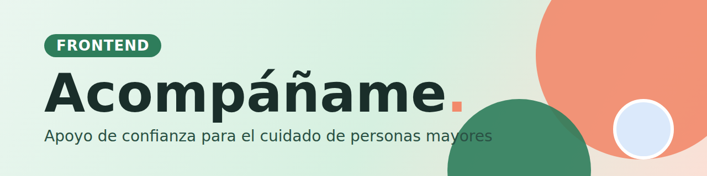
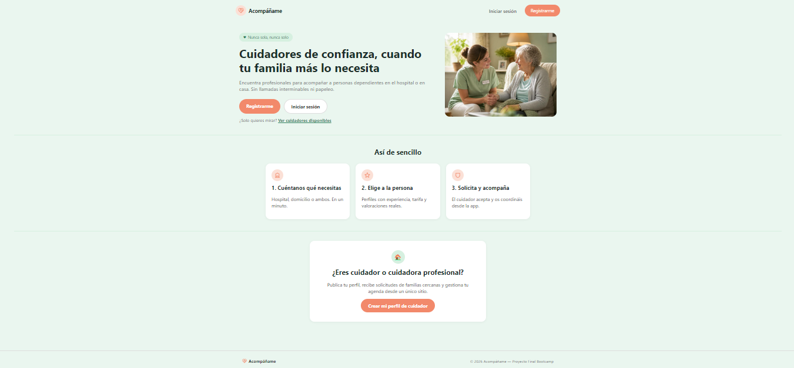
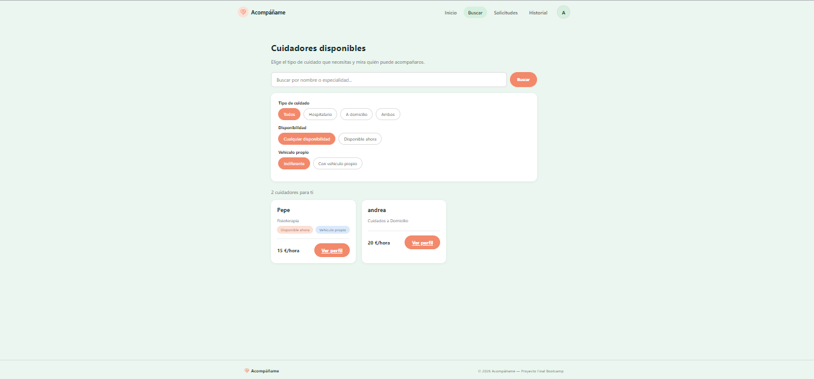
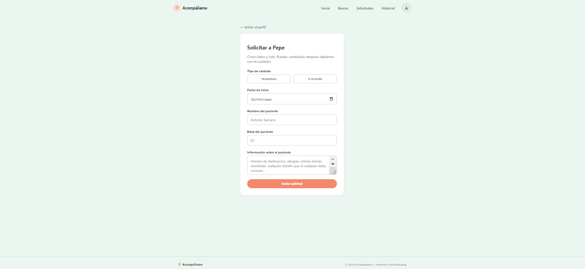
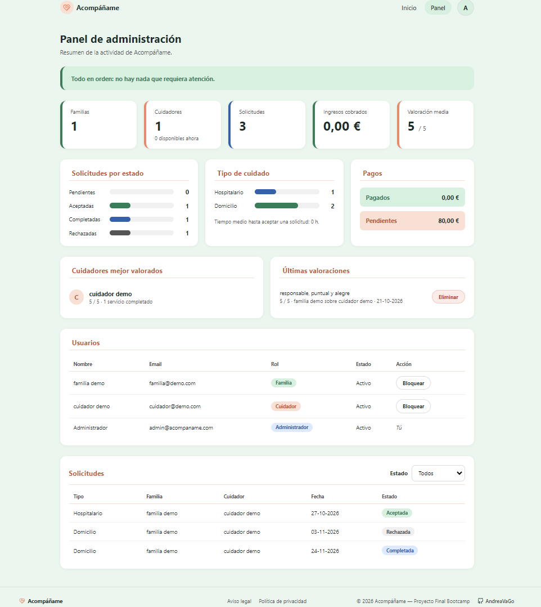
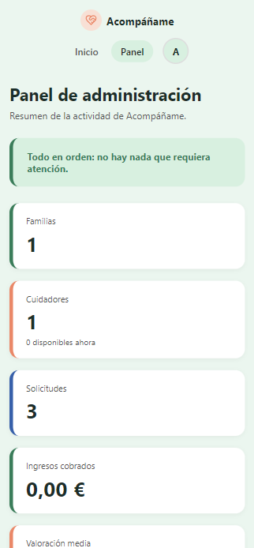
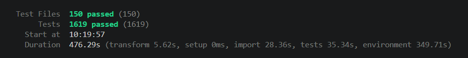
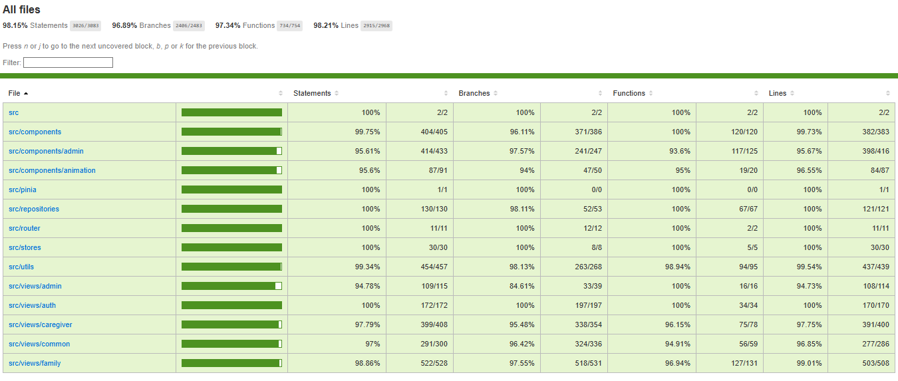

# 🤝 Acompáñame — Frontend

**Acompáñame** is a marketplace that connects families who need care for a loved one with professional caregivers. It was born to fill the gap between full-time residential care and the waiting lists of formal care services.

This repository contains the **web application**, built with **Vue 3**. The REST API (Spring Boot) lives in a separate repository, linked [below](#-project-links).

Final project of the Full Stack Web Development bootcamp (850 h) at **Factoría F5 — Digital Academy**.

     

> [!TIP]
> 📚 **Full documentation is in the [project wiki](https://github.com/AndreaVaGo/acompaname-frontend/wiki).** This README has what you need to understand, run and test the frontend; the details (decisions, design, diagrams and tests) are in the wiki.

---

## 📑 Table of contents

- [What the app does](#-what-the-app-does)
- [Tech stack](#-tech-stack)
- [Getting started](#-getting-started)
- [Configuration](#-configuration)
- [Project structure](#-project-structure)
- [Screens and routes](#-screens-and-routes)
- [Caregiver calendar](#-caregiver-calendar)
- [Admin panel](#-admin-panel)
- [Technical decisions](#-technical-decisions)
- [Design and screenshots](#-design-and-screenshots)
- [Technical diagrams](#-technical-diagrams)
- [Tests](#-tests)
- [Tools](#-tools)
- [Project links](#-project-links)
- [Known limitations](#-known-limitations)
- [Roadmap](#-roadmap)
- [Credits](#-credits)
- [Author](#-author)

---

## 📖 What the app does

**Acompáñame** solves a real problem: finding occasional, trustworthy support for the care of older or dependent people, without having to hire a full residential service.

**Families** can:
- 📝 Sign up and log in (with a CAPTCHA), and recover their password by email
- 🔎 Search caregivers by city, care type, gender, services, availability, vehicle, minimum rating, free dates and **distance** ("caregivers near me"), and read their profile and reviews
- 📋 Send service requests for **up to 5 people** (each with their own age group) and see an estimated price before sending
- 💬 Chat with the caregiver about a request, with an unread-messages badge
- 📍 Open the service address in a map from the request card
- 💳 Pay for a completed service (payments are simulated, see [limitations](#-known-limitations)) and review their payment history
- ⭐ Rate a completed service, once
- 👤 Edit their contact data, change their password and send suggestions to the team

**Caregivers** can:
- 🧑‍⚕️ Sign up and manage their professional profile (photo, specialty, care types, rate, vehicle, availability, travel distance)
- 📥 Receive requests and accept or reject them
- 🗓️ Keep a **calendar of busy time** so families only see them when they are really free (see [Caregiver calendar](#-caregiver-calendar))
- 💬 Chat with families about their requests

The **administrator** can:
- 📊 See a dashboard with the platform activity (families, caregivers, requests, income, average rating), charts and alerts
- 🚫 Block and unblock accounts
- 🗑️ Delete inappropriate reviews
- 📋 Browse all requests filtered by status, and analyse payments
- 💡 Read the suggestions sent by users

Any visitor can read the **legal notice**, the **privacy policy** and the **terms and conditions** from the footer.

---

## 🛠 Tech stack

| Category | Technology |
|---|---|
| 🖖 Framework | Vue 3 (Composition API, `<script setup>`) |
| ⚡ Build tool | Vite 8 |
| 🍍 State | Pinia |
| 🧭 Routing | Vue Router 5 |
| 🔌 API access | Repository Pattern over `fetch`, with a JWT sent as a `Bearer` token |
| 🛡️ CAPTCHA | Cloudflare Turnstile (optional, driven by an environment variable) |
| 🎨 Styles | Plain CSS, BEM naming and CSS variables (fonts: DM Sans and Fraunces) |
| 🧪 Tests | Vitest, Vue Test Utils, jsdom; Playwright for e2e |

---

## 🚀 Getting started

```bash
# Clone the repository
git clone https://github.com/AndreaVaGo/acompaname-frontend.git

# Enter the project folder
cd acompaname-frontend

# Install dependencies
npm install

# Start the development server
npm run dev
```

The app is available at `http://localhost:5173` 🎉.

> [!IMPORTANT]
> To work fully, the backend must be running at `http://localhost:8080` (see the backend README). To log in as administrator, the backend must have been started with the `ADMIN_EMAIL` and `ADMIN_PASSWORD` variables; that README explains how.

| Command | Description |
|---|---|
| `npm run dev` | Development server |
| `npm run build` | Production build (output in `dist/`) |
| `npm run preview` | Preview the production build |
| `npm run test:unit` | Unit tests (watch mode) |
| `npm run test:coverage` | Unit tests with a coverage report (`coverage/index.html`) |
| `npm run test:e2e` | End-to-end tests (backend must be running) |

---

## ⚙️ Configuration

Copy `.env.example` to `.env.local` and adjust it if you need to. Both variables are optional in development.

| Variable | Default | What it does |
|---|---|---|
| `VITE_API_URL` | `http://localhost:8080/api/v1` | Address of the backend API |
| `VITE_TURNSTILE_SITE_KEY` | *(empty)* | **Public** Cloudflare Turnstile site key. If empty, no CAPTCHA is shown on the sign-up and login forms |

Vite embeds these values at build time, so they must be set when running `npm run build`.

### CAPTCHA

The CAPTCHA protects the sign-up and login forms and must be enabled on **both** sides:

1. **Frontend:** set `VITE_TURNSTILE_SITE_KEY`.
2. **Backend:** set `CAPTCHA_ENABLED=true` and `CAPTCHA_SECRET`.

To try it locally without a Cloudflare account, use Cloudflare's test keys: site key `1x00000000000000000000AA` in the frontend and secret `1x0000000000000000000000000000000AA` in the backend (both always pass). In production, create a real Turnstile site and keep the secret key only in the backend.

---

## 📁 Project structure

```
src/
├── assets/          Images, sketches and diagrams
├── components/      Reusable pieces (NavBar, AppFooter, SolicitudCard, CalendarioMensual, LineaDelDia, CaptchaTurnstile...)
│   ├── admin/       Admin panel pieces (menu, alerts, cards, bars, payments, users, reviews, suggestions...)
│   └── animation/   Landing page animations
├── pinia/           Pinia setup
├── repositories/    One class per API resource, all extending a base Repository
├── router/          Route definitions and navigation guards
├── stores/          auth.js (session state)
├── styles/          variables.css, base.css and shared styles
├── tests/           Unit tests (components, views, router, store, repositories, utils)
├── utils/           Pure helper functions (calendar, shifts, price estimate, catalogs, formatting...)
├── views/           One view per screen, grouped in folders: admin, auth, caregiver, common, family
├── App.vue
└── main.js
e2e/                 Playwright end-to-end tests
docs/                Banner, screenshots, design images and project PDFs
```

The structure separates responsibilities: **views** are full screens, **components** are pieces reused across views, **repositories** wrap all communication with the API, the **store** keeps the session state, **utils** hold small pure functions that are easy to test, and the **global styles** avoid repeating design values (colours, spacing).

---

## 📱 Screens and routes

Private routes check in the router that there is a session and, when needed, the role (`FAMILIA`, `CUIDADOR` or `ADMIN`). If the user is not logged in they are redirected to the login; with the wrong role, to the home page. Any unknown address shows a "page not found" screen. Every page sets its own title and description.

### Public

| Screen | Route | Description |
|---|---|---|
| 🏠 Landing | `/` | Welcome page with the value proposition, an animated "how it works" and links to sign up and log in |
| ✍️ Sign up | `/registro` | Form with role selection (family / caregiver), password strength check and CAPTCHA |
| 🔑 Login | `/login` | Email and password with CAPTCHA; the administrator goes straight to the panel |
| 📧 Forgot password | `/olvide-password` | Asks for a reset link by email |
| 🔐 Reset password | `/restablecer-password` | Choose a new password with the link from the email (single use) |
| 🔍 Caregiver search | `/buscar` | List with filters and distance; hides caregivers who are busy on the chosen dates |
| 🧑‍⚕️ Caregiver profile | `/cuidador/:id` | Professional data, average rating and reviews |
| ⚖️ Legal notice, 🛡️ Privacy, 📃 Terms | `/aviso-legal`, `/privacidad`, `/terminos` | Legal pages |

### Families (`FAMILIA`)

| Screen | Route | Description |
|---|---|---|
| 📝 Request a service | `/solicitar/:id` | Care type, address or hospital, dates and hours, up to 5 people with their age group, needs and estimated price |
| ✅ Confirmation | `/confirmacion` | Request sent |
| 📨 My requests | `/solicitudes` | Status of every request, with chat and map link |
| 💳 Checkout | `/pagar/:id` | Payment of a completed service (simulated) |
| 💶 My payments | `/pagos` | Paid and pending amounts |
| ⭐ Rate | `/valorar/:id` | 1–5 stars and a comment, once per completed request |
| 👤 My profile | `/mi-perfil` | Account data |

### Caregivers (`CUIDADOR`)

| Screen | Route | Description |
|---|---|---|
| 📥 Received requests | `/solicitudes-cuidador` | Accept or reject, with chat |
| ✏️ Edit profile | `/editar-perfil` | Photo (JPG, PNG or WebP, shrunk in the browser), specialty, city, care types and services, rate, description, vehicle, availability and travel distance |
| 🗓️ My calendar | `/mi-calendario` | Busy time, shifts, repeat and `.ics` import (see below) |

### Families and caregivers

| Screen | Route | Description |
|---|---|---|
| 💬 Chat | `/chat/:id` | Conversation about a request |
| 💡 Suggestions | `/sugerencias` | Send an idea or a problem to the team |

### Any logged-in user

| Screen | Route | Description |
|---|---|---|
| 📜 History | `/historial` | Final status of every request |
| 🧾 Edit my data | `/editar-datos` | Name, email and phone |
| 🔑 Change password | `/cambiar-password` | Current, new and repeated |

### Administrator (`ADMIN`)

| Screen | Route | Description |
|---|---|---|
| 📊 Admin panel | `/admin` | Side menu with sections for summary, requests, payments, users and suggestions |

Every view has its own empty states (for example, "You have no requests yet") and error messages, so the interface is never broken or blank.

---

## 🗓️ Caregiver calendar

The `/mi-calendario` screen lets caregivers say when they are **not** available, so families never send them requests for those times. It is built from a monthly calendar (`CalendarioMensual`) and a timeline of the selected day (`LineaDelDia`).

**Day colours**

| Colour | Meaning |
|---|---|
| Soft green | Free: nothing noted |
| Light blue | Partly busy: there are busy slots or accepted services, but free hours remain |
| Solid blue, white text | **Full day**: 8 hours or more are busy |

Accepted services count as busy time too. Below the calendar, each day lists its accepted services and its busy slots as cards with a label ("Accepted service" or "Busy"). Each day cell also has a small bar that fills as the day gets busier and is full at 8 hours (480 minutes), and an accessible description ("busy slot", "accepted service", "full day").

**What caregivers can do**

- ➕ **Add a busy slot** for a day, with start time, end time and an optional reason.
- ⏱️ **Quick shifts**: one button each for Morning (07:00–15:00), Afternoon (15:00–23:00) and Night (23:00–07:00). The hours can be changed afterwards. A shift that ends earlier than it starts is a night shift and continues into the next day.
- 🔁 **Repeat** a slot on chosen weekdays (Monday to Friday, every day, or any combination) up to a date, for at most 183 days (about six months). The app tells you how many slots were added and how many already existed.
- 📥 **Import an `.ics` calendar** (Google Calendar, Outlook, Apple Calendar...). Events that are recurring, cancelled, marked as free or already in the past are left out, and a summary says how many were imported, duplicated and skipped.
- 🗑️ Remove a slot at any time.
- 🕒 The timeline of a day shows the **free gaps** between busy slots.

The busy slots are used by the backend in the search filter and when a request is sent. Date and time maths lives in pure functions (`utils/calendario.js` and `utils/turnos.js`) with their own unit tests.

---

## 🛡 Admin panel

The `/admin` screen is only for the `ADMIN` role. The administrator **observes and moderates**: cannot edit requests or payments, delete users or impersonate other accounts.

| Block | What it shows |
|---|---|
| ⚠️ Alerts | What needs attention (for example, pending requests), with a button that opens the Requests section already filtered |
| 🔢 Cards | Families, caregivers (and how many are available now), requests, income collected and average rating |
| 📊 Bars | Requests by status and by care type, with the average time to accept a request |
| ⭐ Reviews | Best-rated caregivers and latest reviews, with a **Delete** button and inline confirmation |
| 👥 Users | Table with role and status, role filter buttons with counters, search box and **Block / Unblock** (in their own row the admin sees "You": it cannot block itself) |
| 📋 Requests | Table with coloured status buttons |
| 💶 Payments | Collected and pending cards, payments per month, bars by status, care type and top-earning caregivers, and a detail table with search and highlighted days unpaid |
| 💡 Suggestions | Suggestions sent by families and caregivers |

Design details:

- The admin menu only has **Panel**, **Change password** and **Log out**: no "My profile" or "Edit my data", so the admin email (created from the backend) cannot be changed from the web.
- The panel is split into sections with a side menu (on mobile, a row of tabs). Only one is shown at a time and data is loaded once on entering.
- Charts are plain text and CSS, with no charting library.
- On **mobile** (under 640 px) the tables turn into cards with label and value, so the Block button is always visible.
- If an account is blocked, the login shows "Wrong email or password, or your account is blocked." (the backend answers the same as with a wrong password).

---

## 🧩 Technical decisions

📄 Full document with the process and the problems found: [docs/decisiones-tecnicas.pdf](docs/decisiones-tecnicas.pdf)

Some of the main decisions:

- 🎨 **BEM + global CSS variables** for colours, radii and spacing.
- 🔌 **Repository Pattern** for API access: every resource has its own repository extending a base class that adds the `Bearer` token and handles errors.
- 🔑 **JWT session**: the token is stored in `sessionStorage` (cleared when the tab closes) and sent in every request. If the server answers 401 with a session open, the session is cleared and the user goes back to the login.
- 🍍 **Session state with Pinia** (`useAuthStore`); the profile photo is kept in memory only because it can be large.
- 🧭 **Shared `NavBar`** that shows different links per role, plus an unread-messages badge.
- 🔎 **Search**: filters run in the browser, the date filter and the distance sort use the backend.
- 🗓️ **Calendar logic in pure functions** (`utils/`), separated from the components so it is easy to test.
- 🖼️ **Photos are shrunk in the browser** (`reducirImagen.js`) before upload.
- 🛡️ **CAPTCHA as an optional component**: with no site key, nothing is shown and the forms work as before.
- 📱 **Responsive design** with media queries (768 px breakpoint).
- 🛡️ **Admin panel split into small components** that receive data through `props` and notify with events; `AdminView` is the only one that talks to the API.
- 📊 **CSS-only charts**, no extra dependencies.
- 🗑️ **Inline confirmation** when deleting a review, instead of a pop-up.
- ♿ **Accessibility**: labels, `aria-label` on calendar cells, focus handling and motion-aware animations (covered by tests).

👉 All the decisions and the way of working: [Technical decisions](https://github.com/AndreaVaGo/acompaname-frontend/wiki/Decisiones-tecnicas).

---

## 🎨 Design and screenshots

Design process: sketches → wireframes → mockups → prototype, for mobile, tablet and desktop.

| Landing | Search | Request |
|---|---|---|
|  |  |  |

| Admin panel (desktop) | Admin panel (mobile) |
|---|---|
|  |  |

👉 Sketches, mockups and all the app screenshots: [Design and screenshots](https://github.com/AndreaVaGo/acompaname-frontend/wiki/Diseno-y-capturas).

---

## 📊 Technical diagrams

Frontend architecture, navigation flow, use cases, sequence diagrams (sign up and login, requesting a service), entity-relationship diagram and class diagram, all in Mermaid and rendered directly on GitHub.

👉 [Technical diagrams](https://github.com/AndreaVaGo/acompaname-frontend/wiki/Diagramas-tecnicos)

---

## ✅ Tests

- **Unit tests** (Vitest + Vue Test Utils): **1,617 tests in 150 files** covering components, views, router, store, repositories and utils. They mock the repository, so they do not need the backend. Coverage: **98.16 %** of statements, **96.9 %** of branches, **97.25 %** of functions and **98.22 %** of lines.
- **End-to-end tests** (Playwright): **31 tests** that open a real browser and go through the main flows (sign up and login, search and request, admin panel, visitor and the photo panel on the auth screens). They **need the backend running**, run one after another because they share the database, and start the frontend by themselves if it is not already running.

```bash
npm run test:unit      # unit tests
npm run test:coverage  # coverage (report in coverage/index.html)
npm run test:e2e       # e2e tests (with the backend running)
```




👉 What each test folder checks, and the e2e tests: [Tests](https://github.com/AndreaVaGo/acompaname-frontend/wiki/Tests).

---

## 🧰 Tools

- 💻 Visual Studio Code
- 🖖 Vue 3 (Composition API)
- 🍍 Pinia
- 🧭 Vue Router
- ⚡ Vite
- ✅ Vitest + Vue Test Utils
- 🎭 Playwright (e2e tests)
- 📮 Postman (integration tests against the backend)
- 🗄️ DBeaver (database inspection during development)
- 📋 JIRA (project management)

---

## 🔗 Project links

| Resource | Link |
|---|---|
| 🍃 Backend repository | https://github.com/AndreaVaGo/acompaname-backend |
| 🖥️ Frontend repository | https://github.com/AndreaVaGo/acompaname-frontend |
| 📊 Project management (JIRA) | https://saludosalamanecer-1780468848301.atlassian.net/jira/software/projects/ACOM/boards/34/timeline?rangeMode=MONTHS |
| 🎨 Design in Figma | https://www.figma.com/design/iNrrCJOe6CkQXTxhGzK7rj/Acomp%C3%A1%C3%B1ame |
| 💜 Prototype (Lovable) | https://care-connection-hub-18.lovable.app |
| 🎤 Presentation | [docs/presentacion.pdf](docs/presentacion.pdf) |

---

## 🐞 Known limitations

> [!NOTE]
> These are the points identified as improvable in the current version (MVP).

- 💳 **Payments are simulated.** The checkout (`/pagar/:id`) marks the payment as completed in the backend, but card data is test data: nothing is charged and there is no real payment gateway.
- 🖼️ Profile photos are sent shrunk and stored as text (Base64) in the database, not as files.
- 📄 Lists (requests, search results) are not paginated yet.
- 🌍 The app is in Spanish only.
- 📲 It is not an installable app (PWA) yet; that needs HTTPS.
- 🔐 No two-factor authentication yet.
- 🎨 Some views still have hand-written colours in their CSS instead of the palette variables.
- 🚫 A person with a blocked account is not told why: the login shows the same message as for a wrong password.

---

## 🗺️ Roadmap

- 💳 Connect the checkout to a real payment gateway (for example Stripe in test mode)
- 🚀 Deploy frontend and backend (with HTTPS and the production environment variables)
- 📄 Paginate long lists
- 🖼️ Store profile photos as files in external storage
- 📲 Turn the app into a PWA
- 🔐 Two-factor authentication
- 🎞️ Review the animations with real users and add screenshots of the new screens to the wiki

---

## 🙏 Credits

- Landing and login photo: *Woman and man holding hands* by Roman Kraft on [Unsplash](https://unsplash.com/es/fotos/mujer-y-hombre-tomados-de-la-mano-0EVKn3-5JSU).
- CAPTCHA: [Cloudflare Turnstile](https://www.cloudflare.com/products/turnstile/).
- Fonts: [DM Sans](https://fontsource.org/fonts/dm-sans) and [Fraunces](https://fontsource.org/fonts/fraunces), through Fontsource.

---

## 👩‍💻 Author

**Andrea Vallina González** — Final project, Full Stack Web Development bootcamp, Factoría F5.

- GitHub: [@AndreaVaGo](https://github.com/AndreaVaGo)
- LinkedIn: [Andrea Vallina González](https://www.linkedin.com/in/andrea-vallina-gonzalez/)